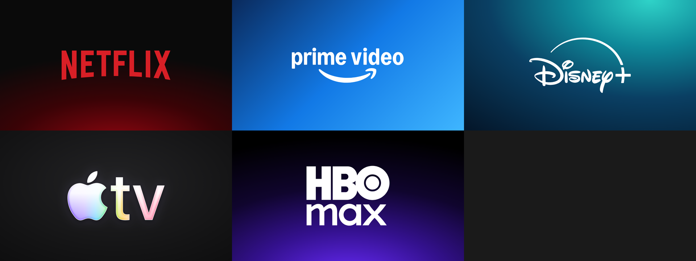

# nuvio-platform-covers

Folder covers for the Platforms collection in Nuvio (Netflix, Prime Video, Disney+, Apple TV, HBO Max). Each one is the
service's vector logo on a gradient in its brand colours, at 1280×720 with the logo kept in the centre so tile crops
never cut it.



Nuvio loads them from the raw GitHub links, for example:

```
https://raw.githubusercontent.com/eltontayzy/nuvio-platform-covers/main/covers/netflix.png
```

## Changing a cover

1. Edit the gradient or logo size for that service in `source/cover.html` (the `C` table).
2. Run `node source/render.mjs` to re-render everything into `covers/`.
3. Commit and push. Nuvio picks up the new image once GitHub's cache expires (about 5 minutes), keeping the same link.

Logos come from Wikimedia Commons. `appletv-lum.svg` rebuilds Apple's 2025 glass Apple TV logo (iridescent rim) on top of
the flat vector mark. The logos are trademarks of their owners and are here only to label the folders in a personal setup.
